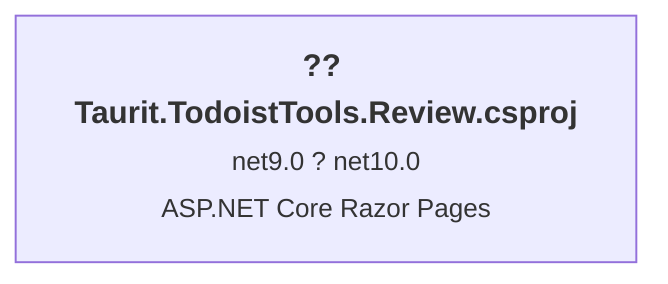

# .NET 10.0 Upgrade Plan

## Table of Contents

- [Executive Summary](#executive-summary)
- [Migration Strategy](#migration-strategy)
- [Detailed Dependency Analysis](#detailed-dependency-analysis)
- [Project-by-Project Plans](#project-by-project-plans)
- [Package Update Reference](#package-update-reference)
- [Breaking Changes Catalog](#breaking-changes-catalog)
- [Testing & Validation Strategy](#testing--validation-strategy)
- [Complexity & Effort Assessment](#complexity--effort-assessment)
- [Risk Management](#risk-management)
- [Source Control Strategy](#source-control-strategy)
- [Success Criteria](#success-criteria)

---

## Executive Summary

### Scenario Description

This plan guides the upgrade of the Taurit.TodoistTools.Review solution from **.NET 9.0** to **.NET 10.0 (Long Term Support)**.

### Scope

**Projects Affected**: 1 project
- Taurit.TodoistTools.Review.csproj (ASP.NET Core Razor Pages application)

**Current State**:
- Target Framework: net9.0
- 4 NuGet packages (1 requires upgrade)
- 586 lines of code across 18 code files
- No project dependencies (standalone application)

**Target State**:
- Target Framework: net10.0
- All packages compatible with .NET 10.0
- 5+ lines requiring review/modification (behavioral changes)

### Selected Strategy

**All-At-Once Strategy** - Single atomic upgrade operation.

**Rationale**:
- Single project solution (no dependency complexity)
- Small codebase (586 LOC)
- Currently on .NET 9.0 (modern .NET, close to target)
- Low difficulty assessment (??)
- No security vulnerabilities
- All package updates have clear versions available
- Minimal breaking changes (5 behavioral changes only)

### Complexity Assessment

**Solution Metrics**:
- Total Projects: 1
- Dependency Depth: 0 (no dependencies)
- Total LOC: 586
- Risk Level: Low (??)
- Security Vulnerabilities: 0

**Complexity Classification**: **Simple**

This is a straightforward upgrade with minimal risk. The single project has no internal dependencies, a small codebase, and well-understood migration path.

### Critical Issues

**Behavioral Changes** (5 issues):
- `System.Net.Http.HttpContent` - 4 occurrences (behavioral change in .NET 10)
- `HttpClientFactoryServiceCollectionExtensions.AddHttpClient` - 1 occurrence (behavioral change in .NET 10)

**Package Updates** (1 required):
- `Microsoft.AspNetCore.Mvc.NewtonsoftJson`: 9.0.11 ? 10.0.1

**Recommended Actions**:
- NuGet package source mappings recommended (best practice)

### Iteration Strategy

Due to the simple nature of this upgrade, the plan will be generated in **3-4 total iterations**:
- **Phase 1**: Discovery & Classification ? (Iterations 1.1-1.3)
- **Phase 2**: Foundation (Iterations 2.1-2.3)
- **Phase 3**: Single-batch detail generation (Iteration 3.1-3.2)

**Expected Remaining Iterations**: 4-5 iterations to complete the plan.

---

## Migration Strategy

### Approach Selection

**Selected Approach**: **All-At-Once Strategy**

This solution is upgraded using a single atomic operation where the project file, package references, and code modifications are all updated together in one coordinated batch.

**Justification**:
1. **Single Project**: No dependency coordination required
2. **Small Codebase**: 586 LOC is manageable in a single update
3. **Modern Starting Point**: .NET 9.0 ? 10.0 is a minor version jump
4. **Low Complexity**: Assessment shows low difficulty (??)
5. **Clear Path**: All packages have known target versions
6. **No Security Issues**: No urgent vulnerabilities requiring separate attention

**All-At-Once Strategy Rationale**:
- Fastest completion time (single upgrade operation)
- No multi-targeting complexity needed
- Clean dependency resolution in one pass
- Simple coordination (no phasing required)
- Solution remains in consistent state throughout

### Dependency-Based Ordering

**Not Applicable**: With a single standalone project, there are no dependency ordering constraints to manage.

The upgrade follows a simple linear sequence:
1. Update project file (TargetFramework)
2. Update package references
3. Restore dependencies
4. Build and address compilation errors
5. Review behavioral changes
6. Test and validate

### Parallel vs Sequential Execution

**Sequential Execution**: All operations are performed sequentially within the single project upgrade task:
- Project file update ? Package updates ? Build ? Fix ? Test

**No Parallelization**: With only one project, there are no opportunities for parallel execution across projects.

### Phase Definitions

#### Phase 0: Preparation
**Purpose**: Verify prerequisites and environment readiness

**Operations**:
- Verify .NET 10.0 SDK installed
- Confirm on `upgrade-to-NET10` branch
- Backup current state (Git commit)

**Deliverable**: Environment ready for upgrade

---

#### Phase 1: Atomic Upgrade
**Purpose**: Execute complete framework and package upgrade in single operation

**Operations** (performed as single coordinated batch):
1. Update project file TargetFramework from net9.0 to net10.0
2. Update Microsoft.AspNetCore.Mvc.NewtonsoftJson from 9.0.11 to 10.0.1
3. Restore NuGet packages
4. Build solution to identify compilation errors
5. Fix any compilation errors discovered
6. Rebuild to verify success
7. Review behavioral changes in code

**Deliverable**: Solution builds with 0 errors and 0 warnings

---

#### Phase 2: Test Validation
**Purpose**: Verify application functionality after upgrade

**Operations**:
- Run application smoke tests
- Test critical Razor Pages functionality
- Verify HTTP client behavior (behavioral changes affect HttpContent)
- Manual testing of key workflows

**Deliverable**: Application functions correctly on .NET 10.0

---

#### Phase 3: Finalization
**Purpose**: Complete upgrade process and document results

**Operations**:
- Review all changes
- Update documentation if needed
- Commit changes with descriptive message
- Optional: Configure NuGet package source mappings (recommended)

**Deliverable**: Upgrade complete and committed

---

## Detailed Dependency Analysis

### Dependency Graph Summary

The solution contains a **single standalone project** with no internal project dependencies.



**Characteristics**:
- **Standalone Application**: No dependencies on other projects in the solution
- **No Dependants**: No other projects depend on this project
- **External Dependencies**: 4 NuGet packages only

### Project Groupings by Migration Phase

**Phase 1: Atomic Upgrade** (All projects - 1 project)
- Taurit.TodoistTools.Review.csproj

**Rationale**: With only one project, there are no dependency constraints to consider. The entire upgrade occurs in a single atomic operation.

### Critical Path Identification

**No Critical Path**: Since there is only one project with no dependencies, there is no critical path to manage. The project can be upgraded independently without coordination concerns.

### Circular Dependency Details

**No Circular Dependencies**: The solution has no project dependencies, therefore no circular dependencies exist.

---

## Project-by-Project Plans

### Project: Taurit.TodoistTools.Review.csproj

#### Current State

- **Target Framework**: net9.0
- **Project Type**: ASP.NET Core Razor Pages application
- **SDK-Style**: True
- **Dependencies**: 0 project dependencies
- **Dependants**: 0 projects depend on this
- **NuGet Packages**: 4 packages
  - Lindhart.Analyser.MissingAwaitWarning (*)
  - Microsoft.AspNetCore.Mvc.NewtonsoftJson (9.0.11)
  - Microsoft.Extensions.Hosting.WindowsServices (10.0.1)
  - Microsoft.TypeScript.MSBuild (5.9.3)
- **Code Metrics**:
  - Total Files: 35
  - Code Files: 18
  - Lines of Code: 586
  - Files with Incidents: 4
- **Risk Level**: ?? Low

#### Target State

- **Target Framework**: net10.0
- **NuGet Packages**: 4 packages (1 updated)
  - Lindhart.Analyser.MissingAwaitWarning (*) - no change
  - Microsoft.AspNetCore.Mvc.NewtonsoftJson (10.0.1) - **upgraded**
  - Microsoft.Extensions.Hosting.WindowsServices (10.0.1) - no change
  - Microsoft.TypeScript.MSBuild (5.9.3) - no change
- **Expected Modifications**: 5+ lines of code (behavioral change reviews)

#### Migration Steps

##### Step 1: Prerequisites
- Verify .NET 10.0 SDK is installed on development machine
- Confirm working directory is on `upgrade-to-NET10` branch
- Ensure no uncommitted changes (clean working directory)

##### Step 2: Update Project File (Taurit.TodoistTools.Review.csproj)

**Target Framework Update**:
```xml
<!-- Change from: -->
<TargetFramework>net9.0</TargetFramework>

<!-- To: -->
<TargetFramework>net10.0</TargetFramework>
```

**Location**: `source/Taurit.TodoistTools.Review/Taurit.TodoistTools.Review.csproj`

##### Step 3: Update Package References

Update the following package in the project file:

| Package | Current | Target | Reason |
|---------|---------|--------|--------|
| Microsoft.AspNetCore.Mvc.NewtonsoftJson | 9.0.11 | 10.0.1 | Framework compatibility |

**Package Update**:
```xml
<!-- Change from: -->
<PackageReference Include="Microsoft.AspNetCore.Mvc.NewtonsoftJson" Version="9.0.11" />

<!-- To: -->
<PackageReference Include="Microsoft.AspNetCore.Mvc.NewtonsoftJson" Version="10.0.1" />
```

**Packages Remaining Unchanged**:
- Lindhart.Analyser.MissingAwaitWarning (*) - Already compatible
- Microsoft.Extensions.Hosting.WindowsServices (10.0.1) - Already .NET 10 version
- Microsoft.TypeScript.MSBuild (5.9.3) - Framework-agnostic

##### Step 4: Restore Dependencies

Execute NuGet restore:
```bash
dotnet restore source/TodoistReview.slnx
```

**Expected Outcome**: All packages restored successfully with no conflicts

##### Step 5: Build Solution

Build the solution to identify any compilation errors:
```bash
dotnet build source/TodoistReview.slnx
```

**Expected Outcome**: Build succeeds (behavioral changes don't cause compilation errors)

##### Step 6: Expected Breaking Changes

**No Binary/Source Breaking Changes**: The assessment shows 0 binary incompatible and 0 source incompatible changes.

**Behavioral Changes to Review** (5 total):

1. **System.Net.Http.HttpContent** (4 occurrences)
   - **Impact**: Behavioral changes in .NET 10 for HttpContent
   - **Action Required**: Runtime testing of HTTP operations
   - **Affected Areas**: Code files using HttpContent (4 files identified)
   - **Testing Focus**: 
     - Request/response handling
     - Content reading/writing
     - Content headers manipulation

2. **HttpClientFactoryServiceCollectionExtensions.AddHttpClient** (1 occurrence)
   - **Impact**: Behavioral change in dependency injection registration
   - **Action Required**: Verify HTTP client factory registration
   - **Affected Areas**: Startup/Program.cs service configuration
   - **Testing Focus**:
     - HTTP client creation via DI
     - Named/typed client registration
     - Client lifetime management

**Files Requiring Review**:
- 4 code files with HttpContent usage patterns
- Startup/Program.cs for AddHttpClient registration

##### Step 7: Code Modifications

**Expected Modifications**: Minimal to none for compilation

**Behavioral Change Review**:
1. Identify all usages of `HttpContent` in the codebase
2. Review HttpContent reading/writing patterns against .NET 10 behavioral changes
3. Verify `AddHttpClient` registration in dependency injection configuration
4. Test HTTP client functionality in affected code paths

**No Obsolete API Replacements Expected**: Assessment shows all APIs are compatible

**Configuration Updates**: None required (ASP.NET Core configuration system unchanged)

##### Step 8: Testing Strategy

**Unit Testing**:
- Run existing unit tests (if any)
- Expected: All tests pass

**Integration Testing**:
- Test HTTP client functionality
- Verify Newtonsoft.Json serialization/deserialization
- Test Razor Pages rendering

**Manual Testing**:
- Start application locally
- Test key user workflows
- Verify HTTP requests to external services work correctly
- Check JSON serialization in API endpoints (if applicable)

**Performance Testing**:
- Monitor application startup time
- Check memory usage patterns
- Verify response times are acceptable

##### Step 9: Validation Checklist

- [ ] Project builds without errors
- [ ] Project builds without warnings
- [ ] All unit tests pass (if tests exist)
- [ ] Application starts successfully
- [ ] Razor Pages render correctly
- [ ] HTTP client operations function correctly
- [ ] Newtonsoft.Json serialization works as expected
- [ ] No runtime exceptions in key workflows
- [ ] No new security vulnerabilities introduced

#### Post-Migration Validation

**Smoke Tests**:
1. Application starts without errors
2. Home page loads successfully
3. All Razor Pages are accessible
4. HTTP requests complete successfully
5. JSON serialization/deserialization works

**Comprehensive Validation**:
1. All existing functionality works as before
2. No performance degradation
3. Logs show no new warnings or errors
4. Application behaves correctly under .NET 10.0

````````

This is the description of what the code block changes:
Fill remaining sections: Package Update Reference, Breaking Changes Catalog, Testing Strategy, Source Control Strategy, and Success Criteria

This is the code block that represents the suggested code change:

````````markdown
## Package Update Reference

### Overview

Total packages: 4
- ? Compatible (no update): 3 packages
- ?? Update Required: 1 package

### Package Update Matrix

| Package | Current Version | Target Version | Projects Affected | Update Reason |
|---------|----------------|----------------|-------------------|---------------|
| **Microsoft.AspNetCore.Mvc.NewtonsoftJson** | **9.0.11** | **10.0.1** | Taurit.TodoistTools.Review.csproj | Framework compatibility - required for .NET 10.0 |
| Lindhart.Analyser.MissingAwaitWarning | * | (unchanged) | Taurit.TodoistTools.Review.csproj | Already compatible with .NET 10.0 |
| Microsoft.Extensions.Hosting.WindowsServices | 10.0.1 | (unchanged) | Taurit.TodoistTools.Review.csproj | Already .NET 10.0 version |
| Microsoft.TypeScript.MSBuild | 5.9.3 | (unchanged) | Taurit.TodoistTools.Review.csproj | Framework-agnostic tooling |

### Package Update Details

#### Microsoft.AspNetCore.Mvc.NewtonsoftJson: 9.0.11 ? 10.0.1

- **Category**: ASP.NET Core Integration Package
- **Purpose**: Provides Newtonsoft.Json support for ASP.NET Core MVC
- **Update Type**: Major version alignment with .NET 10.0
- **Risk Level**: ?? Low
- **Breaking Changes**: None expected (maintains API compatibility)
- **Testing Required**: 
  - JSON serialization/deserialization
  - MVC model binding with JSON
  - API endpoint responses (if applicable)

#### Packages Requiring No Update

**Lindhart.Analyser.MissingAwaitWarning**:
- Version: * (latest)
- Roslyn analyzer package (framework-agnostic)
- No update needed

**Microsoft.Extensions.Hosting.WindowsServices**:
- Version: 10.0.1
- Already on .NET 10.0 version
- No update needed

**Microsoft.TypeScript.MSBuild**:
- Version: 5.9.3
- Build-time tooling (framework-agnostic)
- No update needed

---

## Breaking Changes Catalog

### Summary

The .NET 9.0 ? 10.0 upgrade has **no binary or source breaking changes** for this project.

| Category | Count | Impact |
|----------|-------|--------|
| ?? Binary Incompatible | 0 | None - No code changes required |
| ?? Source Incompatible | 0 | None - No recompilation issues expected |
| ?? Behavioral Changes | 5 | Low - Runtime behavior verification needed |

### Behavioral Changes

Behavioral changes do not break compilation but may affect runtime behavior. All require testing.

#### 1. System.Net.Http.HttpContent (4 occurrences)

**API**: `System.Net.Http.HttpContent`  
**Change Type**: Behavioral Change  
**Affected Files**: 4 code files  
**Impact**: ?? Low - Requires runtime testing

**Description**:
HttpContent behavior has changed in .NET 10.0. This affects how HTTP request and response content is handled.

**Potential Issues**:
- Content reading patterns may behave differently
- Content disposal timing may have changed
- Content header handling may have subtle differences

**Mitigation**:
1. Review all HttpContent usage in the 4 affected files
2. Test HTTP request/response scenarios thoroughly
3. Verify content reading (ReadAsStringAsync, ReadAsStreamAsync, etc.)
4. Check content writing and header manipulation
5. Monitor for any unexpected behavior in HTTP operations

**Testing Required**:
- Unit tests for HTTP client code
- Integration tests with actual HTTP requests
- Verify external API calls work correctly

#### 2. HttpClientFactoryServiceCollectionExtensions.AddHttpClient (1 occurrence)

**API**: `Microsoft.Extensions.DependencyInjection.HttpClientFactoryServiceCollectionExtensions.AddHttpClient`  
**Change Type**: Behavioral Change  
**Affected Files**: 1 file (likely Program.cs or Startup.cs)  
**Impact**: ?? Low - Requires verification

**Description**:
The AddHttpClient extension method has behavioral changes in .NET 10.0 affecting how HTTP clients are registered and created.

**Potential Issues**:
- HTTP client factory registration may have different defaults
- Client lifetime management may have changed
- Handler pipeline configuration may behave differently

**Mitigation**:
1. Review AddHttpClient registration code
2. Verify named/typed client registration still works
3. Test HTTP client creation through DI
4. Ensure client configuration is applied correctly
5. Verify handler pipelines function as expected

**Testing Required**:
- Test HTTP client injection in controllers/services
- Verify named clients resolve correctly
- Check typed client registration
- Test custom handler configuration (if used)

### Framework-Level Changes

**.NET 10.0 Runtime Changes**:
- Review .NET 10.0 release notes for runtime behavioral changes
- Monitor application logs for unexpected warnings
- Test critical paths thoroughly

**ASP.NET Core 10.0 Changes**:
- Verify Razor Pages rendering works correctly
- Check middleware pipeline behavior
- Test routing and endpoint configuration

---

## Testing & Validation Strategy

### Multi-Level Testing Approach

#### Level 1: Build Validation
**Purpose**: Ensure solution compiles successfully

**Steps**:
1. Clean solution: `dotnet clean`
2. Restore packages: `dotnet restore`
3. Build solution: `dotnet build`
4. Verify: 0 errors, 0 warnings

**Success Criteria**:
- ? Build succeeds
- ? No compilation errors
- ? No compilation warnings
- ? All packages restored successfully

#### Level 2: Unit Testing (if applicable)
**Purpose**: Verify individual components function correctly

**Steps**:
1. Discover test projects (if any exist)
2. Run all unit tests: `dotnet test`
3. Review test results

**Success Criteria**:
- ? All unit tests pass
- ? No new test failures
- ? Test coverage maintained

**Note**: Assessment does not indicate presence of test projects. Manual verification may be needed.

#### Level 3: Integration Testing
**Purpose**: Verify application components work together

**Focus Areas**:
1. **HTTP Client Functionality**
   - Test all HTTP requests to external services
   - Verify request/response handling
   - Check error handling

2. **Newtonsoft.Json Serialization**
   - Test JSON serialization
   - Test JSON deserialization
   - Verify model binding

3. **Razor Pages Rendering**
   - Test all Razor Pages load correctly
   - Verify data binding
   - Check form submissions

4. **Dependency Injection**
   - Verify services resolve correctly
   - Test scoped/singleton/transient lifetimes
   - Check HTTP client factory

**Success Criteria**:
- ? All integration scenarios pass
- ? No runtime exceptions
- ? Behavior matches .NET 9.0 version

#### Level 4: Manual/Smoke Testing
**Purpose**: Verify end-to-end application functionality

**Test Scenarios**:
1. **Application Startup**
   - Application starts without errors
   - Logs show no warnings or errors
   - All services initialize correctly

2. **Core User Workflows**
   - Identify 3-5 critical user workflows
   - Test each workflow end-to-end
   - Verify expected behavior

3. **HTTP Operations**
   - Test external API calls
   - Verify data retrieval
   - Check error handling

4. **UI Functionality**
   - Test all Razor Pages
   - Verify navigation
   - Check form submissions and validation

**Success Criteria**:
- ? All smoke tests pass
- ? Application behaves as expected
- ? No user-visible issues

#### Level 5: Performance Validation
**Purpose**: Ensure no performance degradation

**Metrics to Monitor**:
1. Application startup time
2. Page load times
3. HTTP request latencies
4. Memory usage
5. CPU utilization

**Success Criteria**:
- ? Startup time comparable to .NET 9.0
- ? Response times within acceptable range
- ? No memory leaks detected
- ? Resource usage acceptable

### Testing Checklist

#### Pre-Upgrade Testing
- [ ] Document current application behavior
- [ ] Capture baseline performance metrics
- [ ] Identify critical test scenarios
- [ ] Ensure test environment is ready

#### Post-Upgrade Testing
- [ ] Solution builds successfully (0 errors, 0 warnings)
- [ ] All unit tests pass (if applicable)
- [ ] HTTP client operations work correctly
- [ ] Newtonsoft.Json serialization functions properly
- [ ] All Razor Pages render correctly
- [ ] Application starts without errors
- [ ] Critical workflows function as expected
- [ ] Performance is acceptable
- [ ] No new warnings in logs
- [ ] No security vulnerabilities introduced

### Test Environment Requirements

- .NET 10.0 SDK installed
- Development database accessible (if applicable)
- External API endpoints accessible (if applicable)
- Test data prepared
- Monitoring tools available (logs, profilers)

---

## Source Control Strategy

### Branching Strategy

**Main Branch**: `master`
- Remains unchanged during upgrade
- Production-ready state maintained
- Stable baseline for rollback

**Upgrade Branch**: `upgrade-to-NET10`
- All upgrade work performed here
- Created from: `master`
- Isolated from main development

**Merge Approach**:
- After successful testing and validation
- Create Pull Request: `upgrade-to-NET10` ? `master`
- Require code review and approval
- Squash commits or preserve history as preferred

### Commit Strategy

**Recommended Commit Sequence** (Single Commit Approach):

Given the simplicity of this upgrade (single project, minimal changes), a **single atomic commit** is recommended:

```
git add .
git commit -m "Upgrade to .NET 10.0

- Update TargetFramework from net9.0 to net10.0
- Update Microsoft.AspNetCore.Mvc.NewtonsoftJson from 9.0.11 to 10.0.1
- Review HttpContent behavioral changes (4 occurrences)
- Review AddHttpClient behavioral changes (1 occurrence)
- Verify all tests pass
- Confirm application functionality"
```

**Alternative: Granular Commits** (if preferred):

1. **Commit 1: Framework Update**
   ```
   git commit -m "Update TargetFramework to net10.0"
   ```

2. **Commit 2: Package Updates**
   ```
   git commit -m "Update Microsoft.AspNetCore.Mvc.NewtonsoftJson to 10.0.1"
   ```

3. **Commit 3: Code Changes** (if any)
   ```
   git commit -m "Address .NET 10 behavioral changes"
   ```

### Commit Message Format

**Structure**:
```
<Type>: <Subject>

<Body>

<Footer>
```

**Example**:
```
chore: Upgrade solution to .NET 10.0 LTS

- Updated TargetFramework from net9.0 to net10.0
- Updated Microsoft.AspNetCore.Mvc.NewtonsoftJson from 9.0.11 to 10.0.1
- Reviewed and tested HttpContent behavioral changes
- Verified HTTP client factory registration
- All tests passing
- Application functionality confirmed

Closes #<issue-number> (if applicable)
```

### Review and Merge Process

#### Pull Request Requirements

**PR Title**: `Upgrade to .NET 10.0 LTS`

**PR Description Template**:
```markdown
## Summary
Upgrades the Taurit.TodoistTools.Review solution from .NET 9.0 to .NET 10.0 (Long Term Support).

## Changes
- ? Updated TargetFramework: net9.0 ? net10.0
- ? Updated Microsoft.AspNetCore.Mvc.NewtonsoftJson: 9.0.11 ? 10.0.1
- ? Reviewed behavioral changes (5 occurrences)
- ? All tests passing
- ? Application functionality verified

## Testing Performed
- [x] Build succeeds (0 errors, 0 warnings)
- [x] Unit tests pass (if applicable)
- [x] Integration tests pass
- [x] Manual smoke testing complete
- [x] Performance validation complete
- [x] HTTP client functionality verified
- [x] Razor Pages rendering confirmed

## Risk Assessment
?? Low Risk - Single project, minimal changes, no breaking changes

## Rollback Plan
Revert merge commit or reset to master branch
```

#### Review Checklist

**Code Review Focus**:
- [ ] TargetFramework correctly updated to net10.0
- [ ] Package versions correct (10.0.1)
- [ ] No unintended changes included
- [ ] Behavioral change areas reviewed
- [ ] Test results documented

**Merge Criteria**:
- [ ] All tests passing
- [ ] Code review approved
- [ ] CI/CD pipeline succeeds (if applicable)
- [ ] Documentation updated (if needed)
- [ ] No merge conflicts

**Post-Merge Actions**:
- [ ] Verify master branch builds
- [ ] Deploy to staging environment (if applicable)
- [ ] Monitor application in staging
- [ ] Tag release: `v<version>-net10.0`

### Optional: NuGet Package Source Mappings

**Recommendation**: Configure NuGet package source mappings for improved security and performance.

**Implementation**:
Create or update `nuget.config` in solution root:

```xml
<?xml version="1.0" encoding="utf-8"?>
<configuration>
  <packageSources>
    <clear />
    <add key="nuget.org" value="https://api.nuget.org/v3/index.json" />
  </packageSources>
  <packageSourceMapping>
    <packageSource key="nuget.org">
      <package pattern="*" />
    </packageSource>
  </packageSourceMapping>
</configuration>
```

**Benefits**:
- Improved security (prevents package confusion attacks)
- Faster package resolution
- Better build reproducibility
- Best practice for .NET projects

**Commit Separately** (optional):
```
git add nuget.config
git commit -m "Add NuGet package source mappings"
```

---

## Success Criteria

### Technical Criteria

#### Framework Migration Complete
- ? All projects target net10.0
- ? No projects remain on net9.0
- ? All SDK references point to .NET 10.0

#### Package Updates Complete
- ? Microsoft.AspNetCore.Mvc.NewtonsoftJson upgraded to 10.0.1
- ? All packages compatible with .NET 10.0
- ? No package dependency conflicts
- ? No security vulnerabilities in dependencies

#### Build Quality
- ? Solution builds with 0 errors
- ? Solution builds with 0 warnings
- ? All projects restore successfully
- ? No deprecated API warnings

#### Testing Complete
- ? All unit tests pass (if tests exist)
- ? Integration tests pass
- ? Manual smoke tests pass
- ? No runtime exceptions in critical paths

### Quality Criteria

#### Code Quality Maintained
- ? No code quality regressions
- ? Analyzer warnings addressed
- ? Code follows project conventions
- ? No technical debt introduced

#### Test Coverage Maintained
- ? Test coverage level maintained or improved
- ? No tests disabled or skipped
- ? All critical paths tested

#### Documentation Updated
- ? README updated with .NET 10.0 requirements (if applicable)
- ? Build instructions accurate
- ? Deployment documentation reflects new framework
- ? Breaking changes documented (if any)

### Process Criteria

#### All-At-Once Strategy Followed
- ? Single atomic upgrade performed
- ? All updates completed together
- ? No multi-targeting used
- ? Clean dependency resolution

#### Source Control Strategy Followed
- ? All work on `upgrade-to-NET10` branch
- ? Master branch unchanged during development
- ? Commits follow message format
- ? Pull request created and reviewed

#### Behavioral Changes Addressed
- ? HttpContent usage reviewed (4 occurrences)
- ? AddHttpClient registration verified (1 occurrence)
- ? Runtime behavior tested
- ? No behavioral regressions detected

### Optional Criteria (Recommended)

#### Best Practices Implemented
- ? NuGet package source mappings configured
- ? .NET 10.0 SDK version documented
- ? Performance metrics captured
- ? Monitoring in place for production

### Definition of Done

The upgrade is **complete** when:

1. ? All technical criteria met
2. ? All quality criteria met
3. ? All process criteria met
4. ? Pull request merged to master
5. ? Application deployed and verified (if applicable)

### Acceptance Sign-Off

**Upgraded By**: _________________  
**Date**: _________________  
**Reviewed By**: _________________  
**Date**: _________________  

**Notes**: _________________
